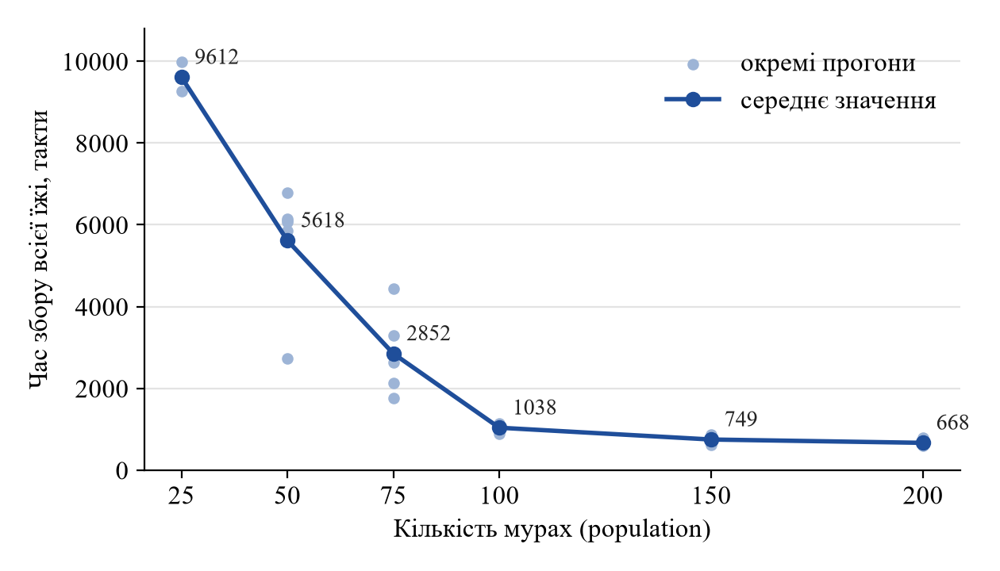
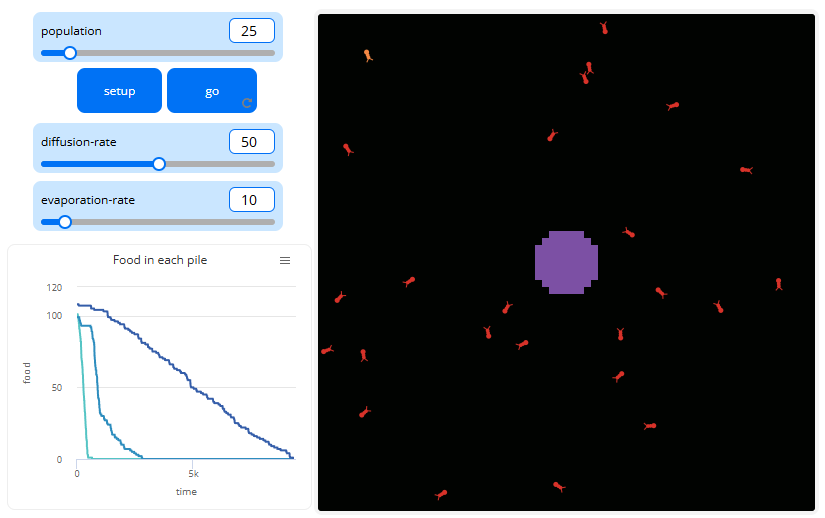
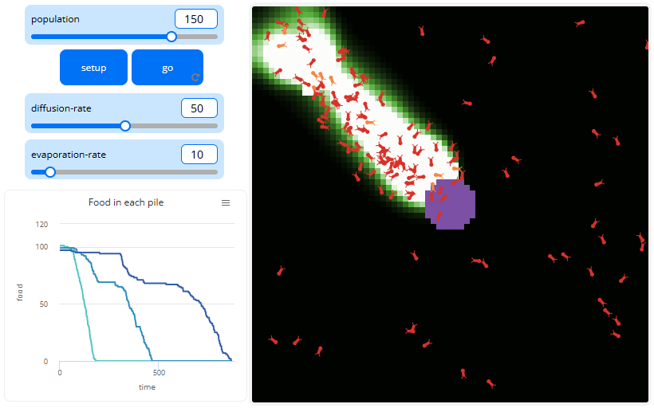
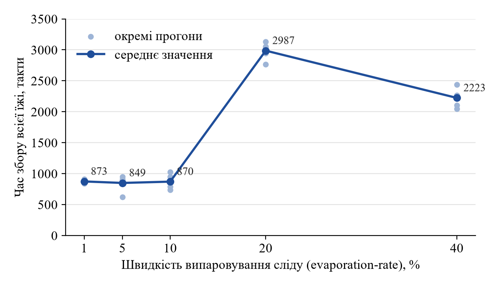
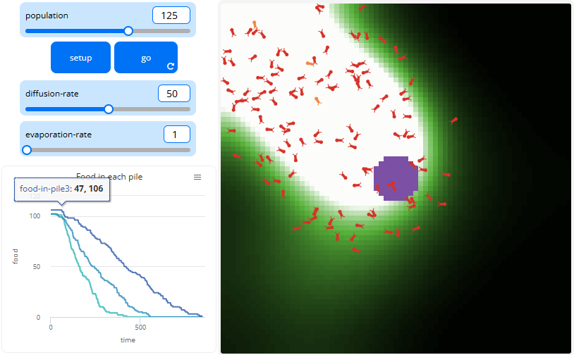
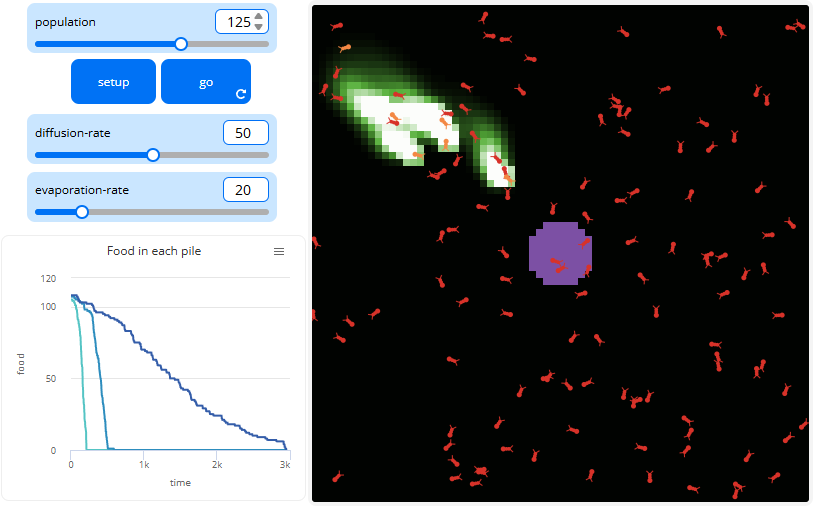
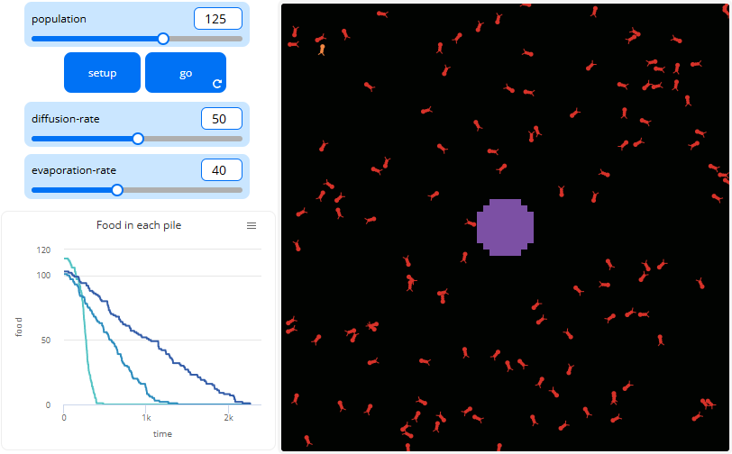
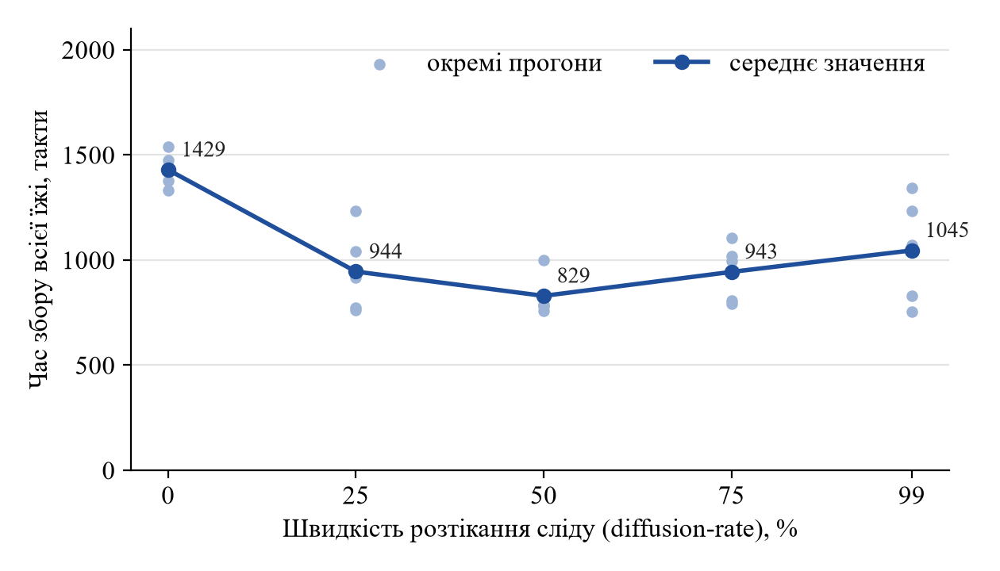
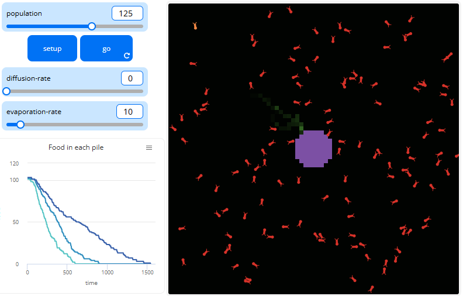
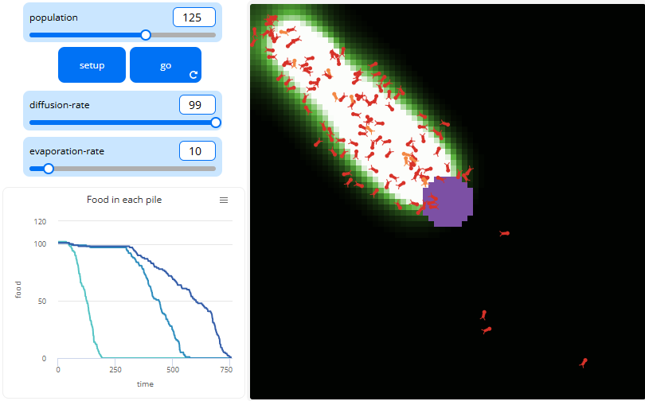

## Комп'ютерні системи імітаційного моделювання
## СПм-25-2, **Протасенко А.С.**
### Лабораторна робота №**1**. Опис імітаційних моделей та проведення обчислювальних експериментів

<br>

### Варіант 10, модель у середовищі NetLogo:
[Ants](http://www.netlogoweb.org/launch#http://www.netlogoweb.org/assets/modelslib/Sample%20Models/Biology/Ants.nlogo)

<br>

### Вербальний опис моделі:
Моделюється колонія мурах, завдання яких — знайти їжу та віднести її до мурашника. Пошук відбувається хаотично: мурахи рухаються не по прямій, а з невеликими випадковими поворотами на кожному кроці. Через це їхній рух має розкид, вони охоплюють більшу площу і частіше випадково натрапляють на їжу.

Щойно мураха бере їжу, вона несе її до мурашника досить оптимальним шляхом, орієнтуючись на запах гнізда. Але випадкові повороти зберігаються, тому вона йде не по прямій, а невеликою дугою, і дорогою залишає за собою феромонний слід.

Слід підказує дорогу іншим мурахам. Коли мураха без їжі натрапляє на слід, він не веде її автоматично ні до їжі, ні до мурашника. Слід є місцем, де мураха рухається з пріоритетом у напрямку посилення запаху, але якщо слід закінчується, вона не «здогадується», куди йти далі, навіть якщо їжа поруч.

У підсумку ближня купка їжі спустошується швидко: мурахи швидко беруть і повертають їжу, тому слід довго залишається сильним. Якщо купка далеко, їжа забирається нерівномірно: мураха, що взяла їжу, приваблює інших мурах, але тільки тих, хто поруч, а оскільки відстань від центру велика, шанс, що поруч буде багато мурах, невеликий.

**Алгоритм зміни станів моделі** (один такт, процедура `go`):
1. Кожна мураха, якій уже дозволено вийти з гнізда (мурахи виходять по одній за такт), діє залежно від стану:
   - *червона* (шукає їжу): якщо на клітинці є їжа — бере одну одиницю, стає помаранчевою і розвертається на 180°; інакше, якщо на клітинці є слабкий слід (0,05 ≤ chemical < 2), повертає в бік найсильнішого запаху феромону (порівнюються клітинки попереду, праворуч і ліворуч під кутом 45°);
   - *помаранчева* (несе їжу): якщо вона в гнізді — віддає їжу, стає червоною і розвертається; інакше додає 60 одиниць феромону на свою клітинку і повертає в бік найсильнішого запаху гнізда.
2. Кожна мураха робить випадковий поворот (до 40° праворуч і ліворуч) і крок вперед; біля краю поля розвертається.
3. Феромон розтікається на сусідні клітинки (`diffusion-rate`) і випаровується (`evaporation-rate`).
4. Клітинки перефарбовуються відповідно до кількості феромону та їжі, модельний час збільшується на один такт.

<br>

### Керуючі параметри:
- **population** — кількість мурах у колонії (від 0 до 200, за замовчуванням 125). Усі мурахи з'являються в гнізді й виходять з нього по одній за такт.
- **diffusion-rate** — швидкість розтікання феромонного сліду на сусідні клітинки (від 0 до 99 %, за замовчуванням 50). Чим більше значення, тим ширший і розмитіший слід.
- **evaporation-rate** — швидкість випаровування сліду (від 0 до 99 %, за замовчуванням 10). На кожному такті кількість феромону на клітинці зменшується на вказаний відсоток, тому чим більше значення, тим швидше слід зникає.

### Внутрішні параметри:
- **chemical** — кількість феромону на клітинці. Мураха з їжею додає 60 одиниць на кожному кроці, після чого феромон розтікається та випаровується.
- **nest-scent** — «запах гнізда» клітинки: чим ближче до гнізда, тим він сильніший. Задається один раз під час setup, за ним мураха з їжею знаходить дорогу додому.
- **food** — кількість їжі на клітинці (1 або 2 одиниці на клітинках трьох джерел їжі).
- **колір мурахи** — її стан: червона мураха шукає їжу, помаранчева несе її до гнізда.

### Показники роботи системи:
- кількість їжі, що залишилася в кожному з трьох джерел (графік «Food in each pile»);
- модельний час (ticks), зокрема кількість тактів, за яку колонія повністю збирає всю їжу.

### Примітки:
- Модель досліджувалася у веб-версії середовища (NetLogo Web).
- Модель не має умови зупинки: після збору всієї їжі мурахи продовжують рухатися. Тому для вимірювання часу збору прогони виконувалися командою в Command Center, яка запускає модель до повного збору їжі та виводить кількість тактів:
  ```
  setup while [any? patches with [food > 0] and ticks < 30000] [go] show ticks
  ```
  Обмеження у 30000 тактів захищає від нескінченного прогону; у жодному з прогонів воно не було досягнуте.
- Через випадковість руху мурах результати окремих прогонів відрізняються, тому для кожного значення параметра модель запускалася 3–6 разів і в таблицях наведено як окремі результати, так і середнє.

### Недоліки моделі:
- **Слід не має напрямку.** Мураха, що шукає їжу, йде в бік сильнішого запаху феромону, а він найсильніший там, де сходиться багато слідів, тобто ближче до гнізда, а не до їжі. До того ж слід враховується лише за слабкої концентрації (0,05 ≤ chemical < 2), а на сильному сліді мураха рухається випадково. Через це мураха часто «губить» дорогу до їжі.
- **Ідеальна навігація до гнізда.** Запах гнізда (`nest-scent`) заданий на всьому полі й ніколи не змінюється, тому мураха з їжею завжди знає дорогу додому. У реальних мурах такої глобальної «карти» немає.
- **Незмінна популяція.** Мурахи не гинуть, не народжуються і не втомлюються, тому модель не може описати розвиток колонії залежно від кількості зібраної їжі.
- **Фіксовані джерела їжі.** Їх завжди три, вони розташовані в одних і тих самих точках і не поновлюються. Кількість зібраної їжі в гнізді ніде не враховується.
- **Немає пам'яті про джерело.** Віддавши їжу, мураха просто розвертається і знову шукає навмання, хоча щойно знала, де їжа.
- **Немає умови зупинки** після збору всієї їжі (див. примітки).

<br>

## Обчислювальні експерименти

### 1. Вплив кількості мурах на час збору їжі
Досліджується залежність часу, за який колонія повністю збирає всю їжу з трьох джерел, від кількості мурах **population**.

Експерименти проводяться при 25, 50, 75, 100, 150 і 200 мурахах, для кожного значення — 3–6 прогонів.

Інші керуючі параметри мають значення за замовчуванням:
- **diffusion-rate**: 50
- **evaporation-rate**: 10

<table>
<thead>
<tr><th>population</th><th>Час збору в окремих прогонах, такти</th><th>Середнє, такти</th></tr>
</thead>
<tbody>
<tr><td>25</td><td>9576, 9989, 9271</td><td>9612</td></tr>
<tr><td>50</td><td>6791, 2739, 6070, 6140, 6112, 5854</td><td>5618</td></tr>
<tr><td>75</td><td>2121, 3298, 1768, 2634, 4439</td><td>2852</td></tr>
<tr><td>100</td><td>1095, 1119, 945, 883, 1149</td><td>1038</td></tr>
<tr><td>150</td><td>762, 782, 620, 719, 863</td><td>749</td></tr>
<tr><td>200</td><td>661, 596, 648, 651, 784</td><td>668</td></tr>
</tbody>
</table>



На рисунках нижче показано вигляд моделі після прогону при 25 та 150 мурахах. При 25 мурахах сталого сліду до дальньої купки не утворюється, і їжа з неї зменшується повільно й майже рівномірно. При 150 мурахах між гніздом і дальньою купкою утворюється широкий стійкий слід («дорога»), по якому рухається колона мурах.





**Висновок.** Залежність часу збору від кількості мурах нелінійна: спочатку час різко зменшується, а після ~100 мурах настає насичення. Збільшення кількості мурах прискорює збір їжі, але не пропорційно. При переході від 25 до 100 мурах (у 4 рази більше) їжа збирається приблизно в 9 разів швидше: чим більше мурах поруч, тим більше шансів, що слід до дальньої купки вціліє і стане довгою «дорогою». При 50–75 мурахах результат найбільше залежить від випадку: слід то утримується, то зникає, тому розкид між прогонами найбільший. Після 100 мурах дороги вже стабільні, і додаткові мурахи дають все менше користі, бо частина з них просто блукає: при подвоєнні кількості з 100 до 200 час зменшується лише в 1,5 раза.

### 2. Вплив швидкості випаровування сліду на час збору їжі
Досліджується залежність часу збору всієї їжі від швидкості випаровування феромонного сліду **evaporation-rate**.

Експерименти проводяться при значеннях 1, 5, 10, 20 і 40 %, для кожного значення — 3–5 прогонів.

Інші керуючі параметри:
- **population**: 125
- **diffusion-rate**: 50

<table>
<thead>
<tr><th>evaporation-rate, %</th><th>Час збору в окремих прогонах, такти</th><th>Середнє, такти</th></tr>
</thead>
<tbody>
<tr><td>1</td><td>866, 912, 842</td><td>873</td></tr>
<tr><td>5</td><td>624, 913, 948, 878, 882</td><td>849</td></tr>
<tr><td>10</td><td>851, 740, 789, 1025, 946</td><td>870</td></tr>
<tr><td>20</td><td>3130, 2764, 3037, 3056, 2947</td><td>2987</td></tr>
<tr><td>40</td><td>2044, 2266, 2105, 2440, 2262</td><td>2223</td></tr>
</tbody>
</table>



Результат при evaporation-rate = 10 (близько 870 тактів) узгоджується з експериментом 1: при 125 мурахах він лежить між значеннями для 100 (1038) і 150 (749) мурах.

На рисунках нижче показано вигляд моделі при різних значеннях evaporation-rate. При 1 % феромон майже не випаровується і заливає велику область навколо гнізда. При 20 % на полі залишаються лише короткі обривки сліду біля дальньої купки. При 40 % сліду практично немає, і всі три купки зменшуються одночасно з самого початку.







**Висновок.** При evaporation-rate від 1 до 10 % час збору майже не змінюється (близько 850–870 тактів): слід живе достатньо довго, щоб утворити стійку «дорогу» навіть до дальньої купки. Між 10 і 20 % відбувається різкий стрибок — час зростає приблизно в 3,5 раза, бо слід до дальньої купки перестає утримуватися. Несподівано при 40 % їжа збирається швидше, ніж при 20 %. Порівняння графіків показує ймовірну причину: при 20 % короткі сліди ще встигають стягнути більшість мурах до ближніх купок, але довести їх до дальньої не можуть, тому вона залишається «на потім». При 40 % сліду немає зовсім, мурахи шукають їжу випадково й рівномірно, і всі купки збираються паралельно. Тобто слабкий слід, що постійно обривається, виявляється гіршим, ніж повна його відсутність.

### 3. Вплив швидкості розтікання сліду на час збору їжі
Досліджується залежність часу збору всієї їжі від швидкості розтікання феромонного сліду на сусідні клітинки **diffusion-rate**.

Експерименти проводяться при значеннях 0, 25, 50, 75 і 99 %, для кожного значення — 5 прогонів.

Інші керуючі параметри:
- **population**: 125
- **evaporation-rate**: 10

<table>
<thead>
<tr><th>diffusion-rate, %</th><th>Час збору в окремих прогонах, такти</th><th>Середнє, такти</th></tr>
</thead>
<tbody>
<tr><td>0</td><td>1423, 1376, 1332, 1475, 1537</td><td>1429</td></tr>
<tr><td>25</td><td>760, 1040, 917, 774, 1231</td><td>944</td></tr>
<tr><td>50</td><td>816, 789, 999, 759, 781</td><td>829</td></tr>
<tr><td>75</td><td>1105, 806, 995, 792, 1016</td><td>943</td></tr>
<tr><td>99</td><td>829, 1342, 1069, 1232, 753</td><td>1045</td></tr>
</tbody>
</table>



Значення при diffusion-rate = 50 (близько 830 тактів) отримане за тих самих налаштувань, що й при evaporation-rate = 10 в експерименті 2 (близько 870 тактів), тобто результати експериментів узгоджуються між собою.

На рисунках нижче показано вигляд моделі при крайніх значеннях diffusion-rate. При 0 слід має вигляд тонкої лінії завширшки в одну клітинку, а при 99 — широкої розмитої плями.





**Висновок.** Залежність часу збору від diffusion-rate має оптимум: найшвидше їжа збирається при значенні близько 50, а при 0 і 99 — повільніше. При 0 слід є тонкою лінією в одну клітинку, і шанс мурахи на неї потрапити малий; до того ж без розтікання поруч зі слідом немає «м'якого краю», за яким мураха визначає напрямок. При 99 слід розпливається на занадто велику область, і в ній надто великий розкид шляхів до їжі, що збільшує час пошуку. Порівняно з експериментом 2 вплив diffusion-rate значно слабший: тривалість дії феромону важливіша, ніж ширина сліду.

<br>

## Загальні висновки
У роботі описано імітаційну модель «Ants» та проведено три обчислювальні експерименти щодо впливу керуючих параметрів на час, за який колонія збирає всю їжу.

1. Найсильніше на результат впливає **кількість мурах**: при зміні population від 25 до 200 середній час збору зменшується з 9612 до 668 тактів, тобто більш ніж у 14 разів. Залежність нелінійна, з насиченням після ~100 мурах.
2. **Швидкість випаровування** має пороговий вплив: до 10 % вона майже не змінює результат, а між 10 і 20 % час збору зростає приблизно в 3,5 раза, бо слід перестає утримуватися до дальнього джерела. Слабкий слід, що обривається, виявився гіршим за повну відсутність сліду.
3. **Швидкість розтікання** впливає найслабше і має оптимум близько 50 %; крайні значення (0 і 99 %) збільшують час збору на 25–70 %.

Ефективність колонії визначається насамперед тим, чи вдається утворити й утримати стійкий слід до кожного джерела їжі: йому сприяють більша кількість мурах і повільне випаровування феромону. Результати різних експериментів за однакових налаштувань (близько 830–870 тактів) узгоджуються між собою, що підтверджує достовірність отриманих даних.
