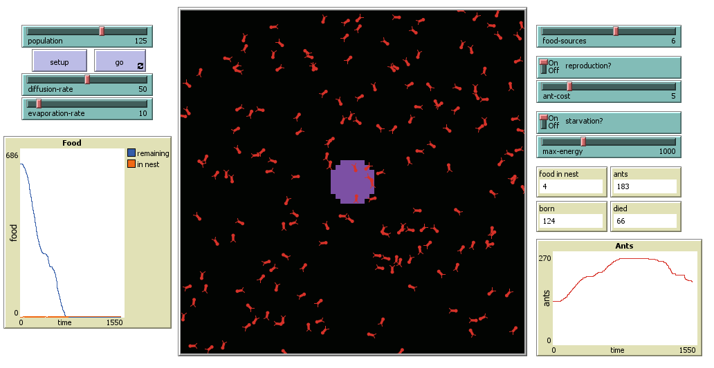
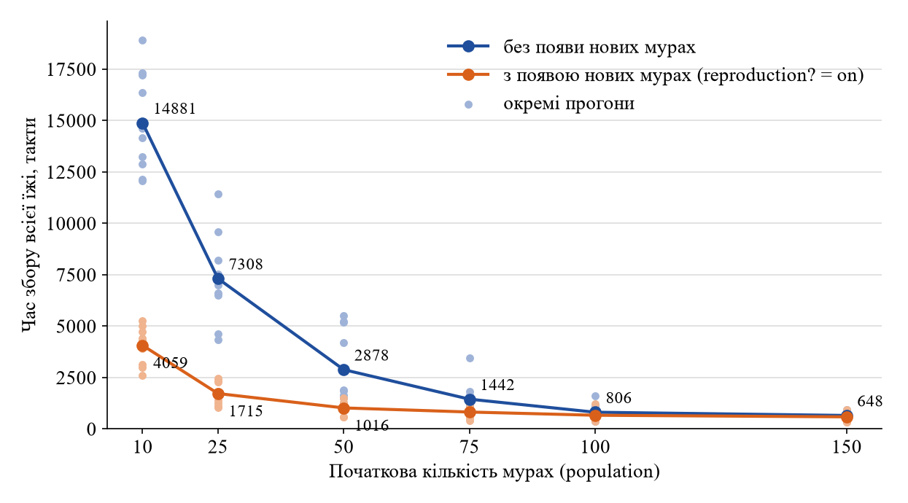

## Комп'ютерні системи імітаційного моделювання
## СПм-25-2, **Протасенко А.С.**
### Лабораторна робота №**2**. Редагування імітаційних моделей у середовищі NetLogo

 

### Варіант 10, модель у середовищі NetLogo:
[Ants](http://www.netlogoweb.org/launch#http://www.netlogoweb.org/assets/modelslib/Sample%20Models/Biology/Ants.nlogo)

Змінена модель: [Ants_modified.nlogo](Ants_modified.nlogo) (NetLogo 6.4.0, десктопна версія — зміни стосуються й інтерфейсу).

 

### Внесені зміни у вихідну логіку моделі, за варіантом:

**1. Можливість вказувати кількість джерел їжі на полі.**
Додано слайдер `food-sources` (від 1 до 10, за замовчуванням 3). В оригіналі було рівно три джерела з жорстко заданими координатами:
<pre>
to setup-food  ;; patch procedure
  ;; setup food source one on the right
  if (distancexy (0.6 * max-pxcor) 0) < 5
  [ set food-source-number 1 ]
  ...
</pre>
Тепер процедура виконується спостерігачем і розміщує задану кількість джерел у випадкових місцях: центр джерела не ближче 15 клітинок до гнізда, не біля краю поля і не ближче 12 клітинок до вже розміщених джерел (щоб купки не зливалися). Кожне джерело — коло радіусом 5 клітинок з 1 або 2 одиницями їжі на клітинці, як і раніше:
<pre>
to setup-food  ;; observer procedure
  let number 1
  while [ number <= food-sources ]
  [ let center one-of patches with
      [ distancexy 0 0 > 15
        and abs pxcor < max-pxcor - 5
        and abs pycor < max-pycor - 5
        and not any? patches in-radius 12
                     with [ food-source-number > 0 ] ]
    if center = nobody [ stop ]  ;; на полі більше немає вільного місця
    ask center
    [ ask patches with [ distance myself < 5 ]
      [ set food-source-number number
        set food one-of [1 2] ] ]
    set number number + 1 ]
end
</pre>
Відповідно, `setup-patches` тепер викликає `setup-food` один раз, а не для кожної клітинки. Кольори джерел (cyan, sky, blue) чергуються через нову функцію `food-color`, бо джерел може бути більше трьох. Графік «Food in each pile», що мав рівно три лінії, замінено графіком «Food» з двома лініями: скільки їжі залишилося на полі і скільки зібрано в гнізді.

**2. Показник кількості зібраної їжі у гнізді.**
Додано глобальну змінну `food-in-nest`, яка збільшується, коли мураха приносить їжу до гнізда, та монітор «food in nest» на інтерфейсі:
<pre>
to return-to-nest  ;; turtle procedure
  ifelse nest?
  [ ;; drop food and head out again
    set food-in-nest food-in-nest + 1
    set color red
    rt 180 ]
  ...
</pre>

**3. Відключаєма можливість появи нових мурах за наявності достатньої кількості їжі у гнізді.**
Додано перемикач `reproduction?` та слайдер `ant-cost` — скільки одиниць їжі потрібно на появу однієї мурахи (за замовчуванням 5). Поки запасу в гнізді вистачає, він витрачається на нових мурах:
<pre>
to reproduce  ;; observer procedure
  while [ food-in-nest >= ant-cost ]
  [ set food-in-nest food-in-nest - ant-cost
    set ants-born ants-born + 1
    create-turtles 1
    [ setup-ant
      set departure ticks ] ]
end
</pre>
Процедура викликається в `go` після руху мурах: `if reproduction? [ reproduce ]`. Нова мураха з'являється в гнізді (точка 0 0) з випадковим напрямком.

Для цього довелося **виправити затримку виходу мурах з гнізда**. В оригіналі мураха виходила, коли номер такту перевищував її номер `who`:
<pre>
if who >= ticks [ stop ] ;; delay initial departure
</pre>
Нові мурахи мають великі `who`, тому вони стояли б у гнізді сотні тактів. Тепер у кожної мурахи є власна змінна `departure` (такт виходу): для початкових мурах це `who` (поведінка як в оригіналі), для нових — такт появи.
<pre>
turtles-own [
  energy
  departure
]
...
if departure >= ticks [ stop ] ;; delay initial departure
</pre>
Початкові налаштування мурахи винесено в окрему процедуру `setup-ant`, що використовується і в `setup`, і в `reproduce`.

**4. Графік зміни кількості мурах.**
Додано графік «Ants» (`plotxy ticks count turtles`), а також монітори «ants» (поточна кількість), «born» (народилося) та «died» (загинуло).

 

### Внесені зміни у вихідну логіку моделі, на власний розсуд:

**Загибель мурах від голоду.** В оригінальній моделі мурахи безсмертні; разом з появою нових мурах це давало б необмежене зростання колонії. Тому додано перемикач `starvation?` та слайдер `max-energy`. Кожна мураха має запас сил `energy`: він зменшується на 1 щотакту, відновлюється до `max-energy`, коли мураха знаходить їжу (підкріплюється біля джерела), а коли доходить до нуля — мураха гине:
<pre>
to starve  ;; turtle procedure
  set energy energy - 1
  if energy <= 0
  [ set ants-died ants-died + 1
    die ]
end
</pre>
<pre>
to look-for-food  ;; turtle procedure
  if food > 0
  [ set color orange + 1     ;; pick up food
    set food food - 1        ;; and reduce the food source
    set energy max-energy    ;; мураха підкріплюється біля джерела
    rt 180                   ;; and turn around
    stop ]
  ...
</pre>
Мурахи, що ще чекають виходу в гнізді, сил не витрачають. Тепер колонія росте, поки є їжа, а коли всі джерела вичерпано — поступово вимирає, що відповідає поведінці реальної колонії без ресурсів.

При вимкнених `reproduction?` і `starvation?` та `food-sources = 3` модель поводиться так само, як оригінал (з тією різницею, що джерела стоять у випадкових місцях).

 

## Обчислювальні експерименти

### 1. Вплив появи нових мурах на залежність часу збору їжі від початкової кількості мурах
Експеримент продовжує дослідження з [лабораторної роботи №1](../Lab1/README.md#1-вплив-кількості-мурах-на-час-збору-їжі): досліджується, як змінюється залежність часу, за який колонія збирає всю їжу, від початкової кількості мурах **population**, якщо увімкнути появу нових мурах (**reproduction?**).

Експерименти проводяться при 10, 25, 50, 75, 100 і 150 мурахах, для кожного значення — по 10 прогонів з вимкненим і з увімкненим **reproduction?** (усього 120 прогонів). Прогони виконувалися засобом BehaviorSpace (без графічного інтерфейсу); прогін завершується, коли на полі не залишається їжі (`not any? patches with [food > 0]`), але не пізніше 30000 тактів.

Інші керуючі параметри:
- **food-sources**: 3
- **ant-cost**: 5
- **starvation?**: off
- **diffusion-rate**: 50
- **evaporation-rate**: 10

<table>
<thead>
<tr><th rowspan="2">population</th><th colspan="2">Середній час збору всієї їжі, такти</th><th rowspan="2">Прискорення, разів</th><th rowspan="2">Мурах наприкінці (reproduction? = on), в середньому</th></tr>
<tr><th>reproduction? = off</th><th>reproduction? = on</th></tr>
</thead>
<tbody>
<tr><td>10</td><td>14881</td><td>4059</td><td>3,7</td><td>72</td></tr>
<tr><td>25</td><td>7308</td><td>1715</td><td>4,3</td><td>86</td></tr>
<tr><td>50</td><td>2878</td><td>1016</td><td>2,8</td><td>109</td></tr>
<tr><td>75</td><td>1442</td><td>816</td><td>1,8</td><td>134</td></tr>
<tr><td>100</td><td>806</td><td>659</td><td>1,2</td><td>159</td></tr>
<tr><td>150</td><td>648</td><td>581</td><td>1,1</td><td>208</td></tr>
</tbody>
</table>

Результати окремих прогонів: [lab2_experiment_raw.csv](lab2_experiment_raw.csv).

Без появи нових мурах залежність така сама, як у лабораторній роботі №1: при малій кількості мурах їжа збирається дуже довго (близько 15000 тактів при 10 мурахах), після ~100 мурах настає насичення. Відмінність від ЛР1 (наприклад, 7308 тактів при 25 мурахах проти 9612) ймовірно, пояснюється тим, що джерела тепер розташовуються випадково і можуть опинитися ближче до гнізда, ніж дальнє джерело в оригіналі; через це й розкид між прогонами більший.

З появою нових мурах крива стає значно пологішою: колонія, що почала з 10 мурах, збирає їжу за ~4000 тактів, а з 25 — за ~1700, тобто в 3,7–4,3 раза швидше. Кожна п'ята принесена одиниця їжі перетворюється на нову мураху, тому мала колонія швидко виростає (з 10 до ~70 мурах) і далі працює як велика. При 100–150 початкових мурахах ефект майже зникає (прискорення в 1,1–1,2 раза): мурах і так достатньо для стійких слідів до всіх джерел, а нові з'являються, коли значна частина їжі вже зібрана.

**Висновок.** Поява нових мурах послаблює залежність часу збору від початкової кількості мурах: колонія сама «нарощує» чисельність до рівня, достатнього для утворення стійких слідів. Найбільший ефект — для малих колоній (до 50 мурах), для великих він незначний. Кількість мурах наприкінці прогону дорівнює початковій плюс приблизно `зібрана їжа / ant-cost`, що підтверджує коректність роботи нової логіки.
