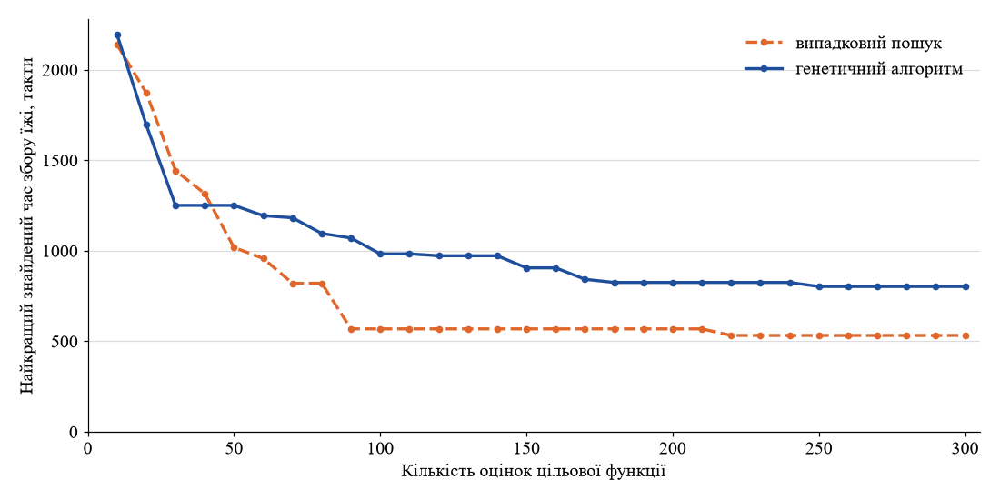
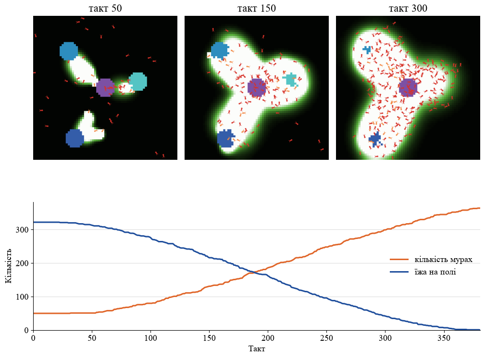
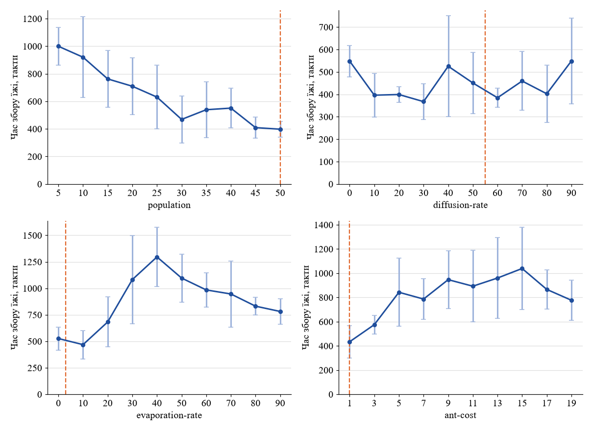

## Комп'ютерні системи імітаційного моделювання
## СПм-25-2, **Протасенко А.С.**
### Лабораторна робота №**3**. Використання засобів обчислювального інтелекту для оптимізації імітаційних моделей

<br>

### Варіант 10, модель у середовищі NetLogo:
[Ants](http://www.netlogoweb.org/launch#http://www.netlogoweb.org/assets/modelslib/Sample%20Models/Biology/Ants.nlogo)

Використано змінену модель з [лабораторної роботи №2](../Lab2/README.md): [Ants_modified.nlogo](Ants_modified.nlogo) (NetLogo 6.4.0). Пошук параметрів виконувався засобом BehaviorSearch 1.10, що входить до складу NetLogo 6.4.0.

<br>

### Модель і показник ефективності

Колонія мурах шукає їжу в трьох купках, розташованих у випадкових місцях поля, і переносить її до гнізда, залишаючи дорогою феромонний слід. У зміненій моделі (ЛР2) за наявності достатньої кількості їжі в гнізді з'являються нові мурахи: кожні **ant-cost** одиниць принесеної їжі перетворюються на одну мураху.

**Показник ефективності** — час збору всієї їжі, тобто номер такту, на якому на полі не залишилося їжі. Це той самий показник, що використовувався в лабораторних роботах №1 і №2, тому результати можна порівняти. Значення показника потрібно **мінімізувати**.

**Керуючі параметри, що налаштовуються:**
- **population** — початкова кількість мурах;
- **diffusion-rate** — відсоток феромону, що розтікається на сусідні клітинки за такт;
- **evaporation-rate** — відсоток феромону, що випаровується за такт;
- **ant-cost** — кількість одиниць їжі, необхідна для появи нової мурахи.

**Незмінні параметри:** **reproduction?** = on (поява нових мурах увімкнена, без неї параметр ant-cost не впливає на модель), **starvation?** = off, **food-sources** = 3, **calorie-mode** = "off". Загибель від голоду вимкнено, щоб колонія не могла вимерти до того, як зібрано всю їжу.

<br>

### Налаштування BehaviorSearch

Файли протоколів пошуку: [ants_random.bsearch](ants_random.bsearch) (випадковий пошук) та [ants_ga.bsearch](ants_ga.bsearch) (генетичний алгоритм). Обидва протоколи відрізняються лише алгоритмом пошуку.

**Опис моделі (Model):**
- команди ініціалізації: `setup`, команди кроку: `go`;
- умова зупинки прогону: `not any? patches with [food > 0]` (усю їжу зібрано);
- обмеження довжини прогону: 5000 тактів (якщо їжу не зібрано, показник дорівнює 5000);
- вимірюваний показник (metric): `ticks`, береться на останньому такті прогону.

**Простір пошуку (Search Space).** Для всіх параметрів задано рівномірний крок зміни значень:

| Параметр | Мінімум | Крок | Максимум | Кількість значень |
|---|---|---|---|---|
| population | 5 | 5 | 50 | 10 |
| diffusion-rate | 0 | 1 | 99 | 100 |
| evaporation-rate | 0 | 1 | 99 | 100 |
| ant-cost | 1 | 1 | 20 | 20 |

Розмір простору пошуку: 10 × 100 × 100 × 20 = 2 000 000 комбінацій, тому повний перебір недоцільний. Верхня межа population обмежена значенням 50, оскільки з лабораторних робіт №1 і №2 відомо, що збільшення кількості мурах завжди прискорює збір їжі. За ширшого діапазону пошук просто знайшов би максимальну кількість мурах.

**Цільова функція (Objective / Fitness):**
- мета: мінімізація;
- значення показника збирається на останньому кроці прогону (At final step);
- кількість повторів для кожної точки: 5, значення цільової функції — середнє арифметичне за повторами (модель стохастична, тому один прогін ненадійний);
- найкраща знайдена точка додатково перевіряється на 20 нових повторах (best checking replicates = 20), щоб оцінити її без впливу випадкового «вдалого» результату.

**Алгоритми пошуку (Search Algorithm):**
- **RandomSearch** (випадковий пошук): на кожному кроці вибирається випадкова точка простору пошуку, запам'ятовується найкраща;
- **StandardGA** (простий генетичний алгоритм): розмір популяції 30, ймовірність мутації 0,05, ймовірність кросоверу 0,7, турнірний відбір з розміром турніру 3, модель популяції «generational» (покоління повністю замінюється новим). Кодування — змішане (MixedTypeChromosome).

Обмеження обчислень для обох алгоритмів однакове — 300 оцінок цільової функції (для ГА це 10 поколінь по 30 особин), кожна оцінка — 5 прогонів моделі. Кеш значень вимкнено, бо модель стохастична. Для кожного алгоритму виконано **5 незалежних пошуків**, щоб порівнювати не одиничні результати, а середні.

<br>

### Результати пошуку

<table>
<thead>
<tr><th rowspan="2">Алгоритм</th><th rowspan="2">Пошук</th><th colspan="4">Найкращі знайдені параметри</th><th colspan="2">Час збору їжі, такти</th></tr>
<tr><th>population</th><th>diffusion-rate</th><th>evaporation-rate</th><th>ant-cost</th><th>під час пошуку (5 повторів)</th><th>перевірка (20 повторів)</th></tr>
</thead>
<tbody>
<tr><td rowspan="5">Випадковий пошук</td><td>1</td><td>50</td><td>55</td><td>3</td><td>1</td><td>410,8</td><td>425,8</td></tr>
<tr><td>2</td><td>40</td><td>5</td><td>12</td><td>1</td><td>458,2</td><td>564,9</td></tr>
<tr><td>3</td><td>50</td><td>64</td><td>12</td><td>2</td><td>623,4</td><td>757,2</td></tr>
<tr><td>4</td><td>45</td><td>33</td><td>0</td><td>1</td><td>516,0</td><td>511,0</td></tr>
<tr><td>5</td><td>40</td><td>77</td><td>94</td><td>1</td><td>652,4</td><td>720,5</td></tr>
<tr><td rowspan="5">Генетичний алгоритм</td><td>1</td><td>45</td><td>32</td><td>16</td><td>1</td><td>730,8</td><td>658,1</td></tr>
<tr><td>2</td><td>50</td><td>22</td><td>75</td><td>1</td><td>737,8</td><td>744,7</td></tr>
<tr><td>3</td><td>50</td><td>66</td><td>2</td><td>9</td><td>971,6</td><td>952,4</td></tr>
<tr><td>4</td><td>30</td><td>66</td><td>10</td><td>2</td><td>799,4</td><td>929,4</td></tr>
<tr><td>5</td><td>20</td><td>5</td><td>96</td><td>1</td><td>811,6</td><td>806,0</td></tr>
</tbody>
</table>

Середнє за 5 пошуками (перевірка на 20 повторах): випадковий пошук — **595,9** такту (від 425,8 до 757,2), генетичний алгоритм — **818,1** такту (від 658,1 до 952,4).

Результати пошуків: [results](results) (файли `*.finalCheckedBests.csv` — найкращі точки, `*.bestHistory.csv` — історія покращень).



На графіку для кожного алгоритму наведено найкраще знайдене значення цільової функції після 10, 20, …, 300 оцінок, усереднене за 5 пошуками. Обидва алгоритми швидко покращують результат протягом перших 50–100 оцінок, після чого покращення стають рідкісними. Випадковий пошук уже після 90 оцінок у середньому знаходить точки з часом ~570 тактів, ГА після 300 оцінок зупиняється на ~800 тактах.

За однакового обмеження в 300 оцінок **випадковий пошук виявився кращим за генетичний алгоритм**. Імовірні причини:
1. **Мала кількість поколінь.** 300 оцінок — це лише 10 поколінь, а ГА потрібно більше поколінь, щоб кросовер і мутація встигли поєднати вдалі значення параметрів.
2. **Зашумлена цільова функція.** Навіть за 5 повторів стандартне відхилення часу збору становить 30–40 % від середнього. Відбір у ГА орієнтується на випадково «вдалі» оцінки, тому популяція може сходитися до неоптимальних точок. Наприклад, у пошуку №4 найкращу точку знайдено вже на 10-й оцінці, і далі вона не покращилася, тобто відбулася передчасна збіжність.
3. **Будова простору пошуку.** Найкращі значення двох найважливіших параметрів лежать на межах діапазонів (population = 50, ant-cost = 1), а від diffusion-rate результат майже не залежить (див. нижче). Випадковий пошук рівномірно перебирає весь простір і порівняно часто потрапляє в потрібну область. ГА ж після кількох поколінь зосереджується навколо вже знайдених точок.

Обидва алгоритми однаково визначили головне: швидше за все їжу збирає велика колонія (population 40–50), у якій нові мурахи з'являються найдешевше (ant-cost = 1–2).

<br>

### Перевірка знайдених параметрів у NetLogo

Найкращу точку (випадковий пошук №1: **population = 50, diffusion-rate = 55, evaporation-rate = 3, ant-cost = 1**) перевірено в NetLogo окремою серією з 20 прогонів. Для порівняння виконано 20 прогонів зі значеннями, що використовувалися в лабораторній роботі №2 (diffusion-rate = 50, evaporation-rate = 10, ant-cost = 5), за тієї ж кількості мурах population = 50.

| Параметри | Середній час, такти | Медіана, такти | Станд. відхилення | Мін. – макс. | Мурах наприкінці |
|---|---|---|---|---|---|
| знайдені (55 / 3 / 1) | 469,2 | 424,5 | 167,6 | 298 – 868 | 346 |
| з ЛР2 (50 / 10 / 5) | 1206,2 | 1001,5 | 577,6 | 623 – 2772 | 110 |

Зі знайденими параметрами колонія збирає всю їжу в середньому в **2,6 раза швидше**, і розкид між прогонами значно менший. Середнє значення (469) близьке до результату перевірки в BehaviorSearch (426), різниця в межах розкиду.

Вигляд моделі під час прогону зі знайденими параметрами (поле моделі на 50, 150 і 300 тактах та графіки кількості мурах і їжі на полі):



Уже на 50-му такті до всіх трьох купок прокладено сліди. Оскільки кожна принесена одиниця їжі перетворюється на нову мураху, колонія зростає приблизно так само швидко, як зменшується їжа на полі. У цьому прогоні всю їжу (322 одиниці) зібрано за 381 такт, кількість мурах зросла з 50 до 364. Модель при знайдених параметрах працює коректно: кількість мурах дорівнює початковій плюс кількість нових мурах (314), а їжа на полі зменшується до нуля.

<br>

### Чутливість результату до параметрів

Щоб перевірити, чи справді знайдена точка є найкращою, і з'ясувати, які параметри важливі, виконано додатковий експеримент у NetLogo (BehaviorSpace): кожен параметр змінювався з рівномірним кроком, а решта залишалися рівними знайденим значенням. Для кожного значення — 10 прогонів (усього 400 прогонів). Файл експериментів: [scripts/verification.xml](scripts/verification.xml).



На графіках показано середній час збору їжі та стандартне відхилення; пунктиром позначено знайдене значення параметра.

| population | 5 | 10 | 15 | 20 | 25 | 30 | 35 | 40 | 45 | 50 |
|---|---|---|---|---|---|---|---|---|---|---|
| Час, такти | 999 | 920 | 763 | 709 | 631 | 469 | 539 | 551 | 409 | 398 |

| diffusion-rate | 0 | 10 | 20 | 30 | 40 | 50 | 60 | 70 | 80 | 90 |
|---|---|---|---|---|---|---|---|---|---|---|
| Час, такти | 548 | 396 | 399 | 367 | 525 | 451 | 385 | 459 | 402 | 549 |

| evaporation-rate | 0 | 10 | 20 | 30 | 40 | 50 | 60 | 70 | 80 | 90 |
|---|---|---|---|---|---|---|---|---|---|---|
| Час, такти | 526 | 468 | 682 | 1082 | 1296 | 1096 | 985 | 946 | 831 | 781 |

| ant-cost | 1 | 3 | 5 | 7 | 9 | 11 | 13 | 15 | 17 | 19 |
|---|---|---|---|---|---|---|---|---|---|---|
| Час, такти | 434 | 575 | 842 | 786 | 947 | 893 | 960 | 1039 | 866 | 777 |

- **population**: час зменшується зі зростанням кількості мурах (з ~1000 до ~400 тактів), найкраще значення — 50, тобто межа діапазону. Це збігається з результатами лабораторних робіт №1 і №2.
- **diffusion-rate**: у всьому діапазоні час коливається між ~370 і ~550 тактами без чіткої тенденції, відмінності менші за розкид. Цей параметр майже не впливає на результат, що узгоджується з ЛР1, де diffusion-rate також впливав найслабше. Тому різні пошуки знаходили для нього зовсім різні значення.
- **evaporation-rate**: найкращими є низькі значення (0–10 %, ~470–530 тактів). Між 10 і 40 % час зростає майже втричі, далі знову поступово зменшується. Різке погіршення після 10 % збігається з результатом ЛР1, де стрибок спостерігався між 10 і 15 %. Зменшення часу при великих значеннях імовірно пояснюється тим, що слід майже одразу зникає і мурахи шукають їжу випадково, а велика колонія з розмноженням знаходить купки і без сліду.
- **ant-cost**: найкраще значення — 1 (434 такти), уже при 3–5 час зростає в 1,3–1,9 раза. Коливання при 13–19 знаходяться в межах розкиду (стандартне відхилення 160–340 тактів).

Отже, знайдена точка справді лежить в області найкращих значень. Результат визначається головним чином трьома параметрами: population, evaporation-rate та ant-cost, а diffusion-rate майже не впливає.

<br>

### Висновки

У роботі за допомогою BehaviorSearch розв'язано задачу оптимізації моделі «Ants» (змінена версія з ЛР2): підбір значень чотирьох параметрів, за яких колонія найшвидше збирає всю їжу. Знайдені параметри (population = 50, diffusion-rate = 55, evaporation-rate = 3, ant-cost = 1) скорочують час збору їжі в 2,6 раза порівняно з параметрами з ЛР2.

За однакового обмеження в 300 оцінок цільової функції випадковий пошук у середньому знайшов кращі рішення, ніж простий генетичний алгоритм (596 проти 818 тактів). Це пояснюється малою кількістю поколінь ГА, зашумленістю цільової функції та тим, що оптимум лежить на межах діапазонів, а один із параметрів майже не впливає на результат. Для генетичного алгоритму в цій задачі доцільно збільшити кількість оцінок, кількість повторів для кожної точки або ймовірність мутації.

Аналіз чутливості з рівномірним кроком підтвердив, що знайдена точка лежить в області найкращих значень, і показав, що найважливішими є кількість мурах, швидкість випаровування феромону та ціна появи нової мурахи. Варто враховувати, що оптимум для population і ant-cost лежить на межах заданих діапазонів, тобто фактично означає «якомога більше мурах і якомога дешевше розмноження». Більш змістовну задачу можна отримати, якщо додати до цільової функції «вартість» колонії, наприклад кількість мурах наприкінці прогону.

<br>

### Запуск

Пошуки виконувалися без графічного інтерфейсу (з каталогу встановлення NetLogo):
```
java -Dbsearch.appfolder=behaviorsearch -classpath "app\*" bsearch.app.BehaviorSearch -p ants_random.bsearch -o results\random -n 5 -b
java -Dbsearch.appfolder=behaviorsearch -classpath "app\*" bsearch.app.BehaviorSearch -p ants_ga.bsearch -o results\ga -n 5 -b
```
`-p` — файл протоколу, `-o` — початок імен файлів результатів, `-n` — кількість незалежних пошуків, `-b` — не зберігати повну історію прогонів. Штатний скрипт `behaviorsearch_headless.bat` у NetLogo 6.4.0 не працює (шукає бібліотеки не в тій папці), тому BehaviorSearch запускався безпосередньо через Java. Ті самі протоколи можна відкрити в графічному інтерфейсі BehaviorSearch (File → Open).

Експерименти перевірки виконувалися засобом BehaviorSpace:
```
netlogo-headless.bat --model Ants_modified.nlogo --setup-file scripts/verification.xml --experiment check-best --table results/check-best.csv
```
(аналогічно для експериментів `check-default`, `sweep-population`, `sweep-diffusion-rate`, `sweep-evaporation-rate`, `sweep-ant-cost`).
